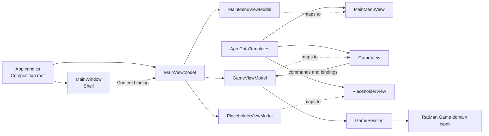
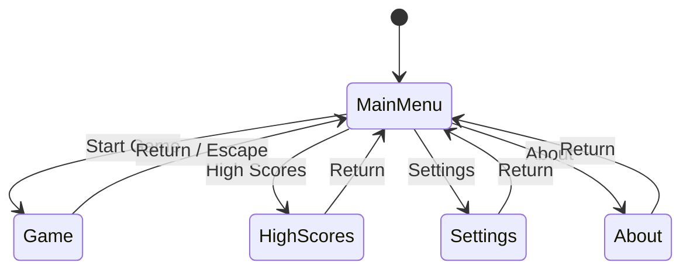

# Week 3 Architecture

## MVVM and dependency flow

## Screen navigation

This is application navigation, not the gameplay state machine planned for Week 6. Placeholder screens deliberately avoid implementing future persistence or state rules early.

## Responsibilities

| Component | Responsibility |
| --- | --- |
| `App.xaml.cs` | Constructs the shell and root view model; supplies the exit action. |
| `MainWindow` | Hosts the active screen through one `ContentControl`. |
| `MainViewModel` | Owns available screens and changes `ActiveScreen`. |
| `MainMenuViewModel` | Exposes user navigation commands. |
| `GameViewModel` | Projects engine state into Canvas coordinates and adapts movement commands. |
| `PlaceholderViewModel` | Supplies content and return navigation for later features. |
| `ObservableObject` | Implements reusable property-change notification. |
| `RelayCommand` | Adapts delegates to WPF `ICommand`. |
| `GameView` | Renders the board and actor and owns game-only keyboard bindings/focus. |
| `RatMan.Game` | Owns positions, board bounds, player state, and movement rules without WPF dependencies. |

## Boundary rules

1. `RatMan.Game` does not reference WPF or `RatMan.App`.
2. Views do not mutate domain objects directly.
3. Domain grid coordinates are converted to pixels in `GameViewModel`.
4. `MainWindow` contains no navigation or gameplay logic.
5. Resource dictionaries own reusable presentation values; game rules do not depend on those resources.
6. Keyboard focus handling is view-specific code-behind because it is a WPF presentation concern.
